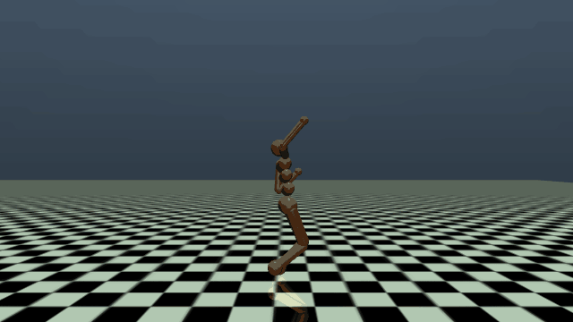
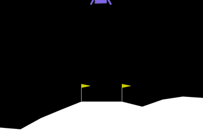
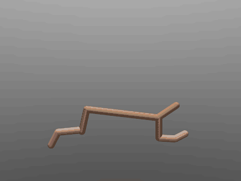
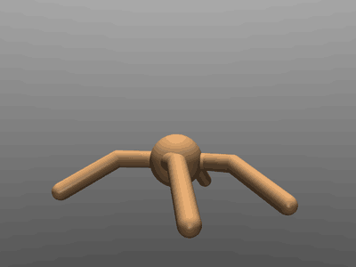

# [2026/2027 Edition] RL from Scratch

From-scratch implementations of reinforcement learning algorithms in PyTorch. With recent versions of torch, gymnasium, numpy and mujoco!

<table>
  <tr>
    <td align="center"><br><sub>SAC on Humanoid-v5</sub></td>
    <td align="center"><br><sub>PPO on LunarLander-v3 (continuous)</sub></td>
  </tr>
  <tr>
    <td align="center"><br><sub>DDPG on HalfCheetah-v5</sub></td>
    <td align="center"><br><sub>TD3 on Ant-v5</sub></td>
  </tr>
</table>

## Why

Many of these are built directly from the original papers, not adapted from existing code. Using a library tells you that an algorithm works. Writing it yourself shows you why, and where it breaks.

## What's in here

The repo grows in no particular order. Some algorithms are simple, some are more involved, and I upload whatever I'm currently working on while walking through the reinforcement learning jungle. The same algorithm can show up more than once, on a different environment or with a different action space, because that is often where the interesting problems are.

Every file is self-contained. Run it, it trains, and at the end it renders the trained agent.

| File | Algorithm | Environment | Notes |
|---|---|---|---|
| `reinforce_cartpole.py` | REINFORCE | CartPole-v1 | Monte Carlo policy gradient |
| `reinforce_LunarLander.py` | REINFORCE | LunarLander-v3 | Same algorithm on a harder task |
| `vanilla_AC_cartpole.py` | Actor-Critic | CartPole-v1 | One-step TD advantage, separate actor and critic |
| `entropy_AC_frozenLake.py` | Actor-Critic + entropy bonus | FrozenLake-v1 (8x8) | Sparse reward, entropy term keeps exploration alive |
| `ppo_cartpole_pure.py` | PPO | CartPole-v1 | Minimal version, under 80 lines |
| `ppo_cartpole.py` | PPO | CartPole-v1 | Full version with checkpoints, diagnostics (KL, clip fraction, explained variance) and plots |
| `ppo_discrete_action_space_acrobot.py` | PPO | Acrobot-v1 | Discrete actions |
| `ppo_continuous_lunar_lander.py` | PPO | LunarLander-v3 (continuous) | Gaussian policy |
| `ppo_continuous_action_space_walker.py` | PPO | BipedalWalker-v3 | Continuous actions, running observation normalization |
| `ppo_mixed_action_space_CarRacing.py` | PPO | CarRacing-v3 | Mixed action space (Gaussian steering + categorical pedals), CNN on stacked frames |
| `dqn_cnn_breakout.py` | Double DQN | ALE/Breakout-v5 | CNN, replay buffer, Atari wrappers, TensorBoard logging |
| `ddpg_halfCheetah.py` | DDPG | HalfCheetah-v5 (MuJoCo) | OU noise, soft target updates, residual blocks, flip penalty wrapper |
| `td3_ant.py` | TD3 | Ant-v5 (MuJoCo) | Twin critics, delayed policy updates, target policy smoothing |
| `sac_3d.py` | SAC | Humanoid-v5 (MuJoCo) | Squashed Gaussian policy, twin critics, automatic entropy tuning, residual blocks with LayerNorm |

## Roadmap

- [x] REINFORCE
- [x] Actor-Critic
- [x] PPO (discrete, continuous, mixed action space)
- [x] DQN / Double DQN
- [x] DDPG
- [ ] A2C
- [ ] A3C
- [x] TD3
- [ ] TRPO
- [ ] Rainbow
- [ ] D4PG
- [x] SAC
- [ ] MADDPG

## Tutorials

Once enough algorithms and environments are covered, I will start recording video walkthroughs on my YouTube channel.

## Requirements

- Python 3
- PyTorch
- Gymnasium

Some environments need extras:

```bash
pip install "gymnasium[box2d]"    # LunarLander, BipedalWalker, CarRacing
pip install "gymnasium[mujoco]"   # HalfCheetah, Ant, Humanoid
pip install ale-py                # Breakout
pip install torchvision           # CarRacing
pip install tensorboard           # DQN logging
pip install matplotlib            # PPO CartPole plots
```

## Papers

| Algorithm | Paper |
|---|---|
| REINFORCE | [Williams, 1992. Simple Statistical Gradient-Following Algorithms for Connectionist Reinforcement Learning](https://doi.org/10.1007/BF00992696) |
| Actor-Critic | [Barto, Sutton, Anderson, 1983. Neuronlike Adaptive Elements That Can Solve Difficult Learning Control Problems](https://doi.org/10.1109/TSMC.1983.6313077) |
| | [Konda, Tsitsiklis, 1999. Actor-Critic Algorithms](https://papers.nips.cc/paper/1786-actor-critic-algorithms) |
| DQN | [Mnih et al., 2013. Playing Atari with Deep Reinforcement Learning](https://arxiv.org/abs/1312.5602) |
| | [Mnih et al., 2015. Human-level control through deep reinforcement learning](https://doi.org/10.1038/nature14236) |
| Double DQN | [van Hasselt, Guez, Silver, 2015. Deep Reinforcement Learning with Double Q-learning](https://arxiv.org/abs/1509.06461) |
| Rainbow | [Hessel et al., 2017. Rainbow: Combining Improvements in Deep Reinforcement Learning](https://arxiv.org/abs/1710.02298) |
| TRPO | [Schulman et al., 2015. Trust Region Policy Optimization](https://arxiv.org/abs/1502.05477) |
| GAE | [Schulman et al., 2015. High-Dimensional Continuous Control Using Generalized Advantage Estimation](https://arxiv.org/abs/1506.02438) |
| PPO | [Schulman et al., 2017. Proximal Policy Optimization Algorithms](https://arxiv.org/abs/1707.06347) |
| A3C / A2C | [Mnih et al., 2016. Asynchronous Methods for Deep Reinforcement Learning](https://arxiv.org/abs/1602.01783) |
| | [OpenAI, 2017. OpenAI Baselines: ACKTR & A2C](https://openai.com/index/openai-baselines-acktr-a2c/) |
| DDPG | [Lillicrap et al., 2015. Continuous control with deep reinforcement learning](https://arxiv.org/abs/1509.02971) |
| TD3 | [Fujimoto, van Hoof, Meger, 2018. Addressing Function Approximation Error in Actor-Critic Methods](https://arxiv.org/abs/1802.09477) |
| D4PG | [Barth-Maron et al., 2018. Distributed Distributional Deterministic Policy Gradients](https://arxiv.org/abs/1804.08617) |
| SAC (v1) | [Haarnoja et al., 2018. Soft Actor-Critic: Off-Policy Maximum Entropy Deep RL with a Stochastic Actor](https://arxiv.org/abs/1801.01290) |
| SAC (v2) | [Haarnoja et al., 2018. Soft Actor-Critic Algorithms and Applications](https://arxiv.org/abs/1812.05905) |
| MADDPG | [Lowe et al., 2017. Multi-Agent Actor-Critic for Mixed Cooperative-Competitive Environments](https://arxiv.org/abs/1706.02275) |
